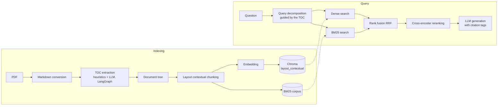

# manual-rag

A RAG (Retrieval-Augmented Generation) stack for **technical manuals in PDF format that contain a table of contents**. It answers questions in natural language and cites the page and section of each source passage.

This README documents the **contextual layout** configuration (`--chunk-with-layout-context`), the one used for the final results.

---

## 1. What "contextual layout" means

Instead of cutting the manual into fixed-size pieces, the document is cut **along its own structure**:

1. The table of contents (TOC) is extracted and turned into a tree (document → chapters → sections → blocks).
2. Chunks are built **inside a section**: they never cross a section boundary.
3. Blocks (text, tables, code) are kept whole when possible. A block larger than the window is split with a sliding window and an overlap. Images are not embedded.
4. **Contextual part:** before embedding, the 2-level section path (the section title and its parent) is prepended to each chunk. Only the *embedded* text contains the path; the stored text stays the original chunk.

| Flag | Variant | Vector collection |
|---|---|---|
| *(none)* | vanilla chunking | `vanilla` |
| `--chunk-with-layout` | layout chunks, no path prefix | `layout` |
| `--chunk-with-layout-context` | layout chunks + section path prefix | `layout_contextual` |

If both layout flags are given, the contextual one wins.

---

## 2. Architecture

### 2.1 Pipeline



### 2.2 Stages

**Indexing**
- **Markdown conversion:** the PDF is converted page by page; tables, images and text are reassembled in reading order, and each page keeps its number.
- **TOC extraction:** only the first pages are candidates; they are scored with structure heuristics (title, page numbers, numbered entries, dot leaders). The best early page is probed by an LLM in a LangGraph loop that follows the TOC across pages until it ends.
- **Tree construction:** one node per TOC entry, content attached as text/table/image leaves with page and section title.
- **Chunking, embedding, storage:** layout contextual chunks are embedded with a Sentence Transformers model and stored in Chroma. The same chunks feed the BM25 index.

**Retrieval** (for each sub-query)
- **Query decomposition:** an LLM splits multi-hop questions into sub-queries, using the TOC to know which topics the manual covers. If no split is needed, the original question is used.
- **Hybrid search:** dense (Chroma) + sparse (BM25), each returning its top candidates.
- **Reciprocal Rank Fusion:** `RRF(c) = Σ 1 / (k + rank(c))`, with `k = 60`.
- **Reranking:** a cross-encoder rescored the fused candidates; only the best chunks go to generation.

**Generation**
- Each retained chunk is tagged with its id, page and section title, so the LLM can cite it.
- If no chunk is retained for a sub-query, no LLM call is made and the system says nothing relevant was found.
- Sub-query answers are combined; the final **confidence is the lowest** among the sub-queries.

### 2.3 Software design

The code follows a **hexagonal (ports and adapters)** architecture: the RAG logic in `core/` depends only on interfaces, and each external capability has adapters created by a factory from the settings.

| Port | Adapters |
|---|---|
| LLM client | Gemini (cloud API), Ollama (local models) |
| Embedding provider | Sentence Transformers |
| Vector store | Chroma |
| Reranker | Cross-encoder |

```
manual_rag/
  cli.py              entry point, builds the components
  config.py           centralized settings
  logging_config.py
  core/               ports (interfaces) and models
  embeddings/         embedding adapters + factory
  llm/                LLM adapters + factory
  rerankers/          reranker adapters + factory
  vectorstore/        vector store adapters + factory
  indexing/           parsing, TOC, tree, chunking, BM25
  retrieval/          retrieval strategies + factory
  prompts/            LLM prompts
  eval/               evaluation harness
  app/                Streamlit viewer
  utils/              text, tracing, JSON helpers
```

> The report's project-structure figure calls the root package `advanced_rag/`; the code imports it as `manual_rag`. Use whichever name your repository actually has.

---

## 3. Installation

```bash
python -m venv .venv
source .venv/bin/activate          # Windows: .venv\Scripts\activate
pip install -e .                   # or: pip install -r requirements.txt
```

Choose the LLM in `manual_rag/config.py` (settings object `Settings`):

- **Gemini (cloud API):** set your API key as the settings expect (see `config.py`).
- **Ollama (local):** install Ollama, pull a model, and keep the Ollama server running. Use this for confidential documents.

The embedding model and the cross-encoder are downloaded on first use.

---

## 4. How to run (contextual layout)

All commands are `manual-rag <command>`. If the console script is not installed, use `python -m manual_rag.cli <command>`.

**Golden rule:** pass the **same** `--chunk-with-layout-context` flag to `index`, `query`, `chat` and `evaluate`. The flag selects which vector collection and BM25 corpus are loaded; a mismatch silently queries the wrong index.

### Step 1: build the index

```bash
manual-rag index manual.pdf manual_index.json \
  --chunk-with-layout-context \
  --retriever layout \
  --no-auto-retrieve
```

This produces `manual_index.json` (the tree), fills the Chroma collection `layout_contextual`, and writes the BM25 corpus.

### Step 2: ask questions

```bash
# one question
manual-rag query manual_index.json "How do I configure the backup schedule?" \
  --chunk-with-layout-context --retriever layout

# interactive session (type exit, quit, or Ctrl-D to leave)
manual-rag chat manual_index.json --chunk-with-layout-context --retriever layout
```

### Step 3: evaluate

```bash
manual-rag evaluate manual_index.json questions.csv results/run1 \
  --chunk-with-layout-context --retriever layout
```

### Step 4: browse the index (optional)

```bash
manual-rag view manual_index.json
```

This only prints how to start the Streamlit viewer, then upload the JSON in the sidebar.

---

## 5. CLI reference

### Shared options

| Option | Meaning |
|---|---|
| `--chunk-with-layout-context` | Select the contextual layout variant (collection `layout_contextual`). **Required on every command** for this configuration. |
| `--retriever NAME` | Retrieval strategy (choices come from `STRATEGIES` in `retrieval/factory.py`). Default `tree`. |
| `--no-split-subqueries` | Disable query decomposition: the question is used as a single query. Supported by the `tree` and `layout` strategies. |

> **Important, `--retriever`:** the default `tree` strategy does **not** load the vector store or the BM25 corpus, so it does not use your contextual chunks. For this configuration pass the strategy that runs hybrid retrieval over the chunks (`layout`, to be confirmed against `STRATEGIES`).

### `index`: build and save an index

```
manual-rag index <pdf> <output> [options]
```

| Argument / option | Meaning |
|---|---|
| `pdf` | Path of the manual (PDF with a table of contents). |
| `output` | Where to save the tree index (JSON). |
| `--mode {auto,toc,no_toc}` | How the structure is obtained. `auto` (default) decides by itself. |
| `--skip-llm-summarization` | Skip the LLM summaries of sections (faster, cheaper). |
| `--auto-retrieve-mode {smoke_test,interactive}` | What to do right after indexing: run the smoke-test queries from the settings (default) or open an interactive session. |
| `--no-auto-retrieve` | Do nothing after indexing. |

What it does: selects the collection, sets the chunk size to `min(configured size, embedder max tokens)`, sets the overlap to `size × overlap ratio` if not fixed, then runs the indexing pipeline (conversion, TOC, tree, chunking, embedding, Chroma, BM25).

### `query`: one question

```
manual-rag query <index_path> "<question>" [options]
```

Loads the index, builds the retriever once, runs the question, and prints the answer with its **confidence**.

### `chat`: interactive session

```
manual-rag chat <index_path> [options]
```

Same as `query`, but the retriever is built once and reused for many questions. Empty input, `exit`, `quit` or Ctrl-D ends the session; an error on one question does not stop it.

### `evaluate`: retrieval evaluation

```
manual-rag evaluate <index_path> <csv_path> <output_prefix> [options]
```

| Argument / option | Meaning |
|---|---|
| `csv_path` | Evaluation questions with their reference sections and pages. |
| `output_prefix` | Prefix of the result files. |
| `--limit N` | Evaluate only N questions. |
| `--start-at N` | Start at question N (to continue a run). |
| `--resume` | Declared by the parser but **not currently passed to the evaluator**, so it has no effect; use `--start-at` instead. |

Metrics reported: precision, recall, F1, hit rate, context precision and MRR. Chunks are matched to the reference by **section name**, not by id, so scores are approximate.

### `view`: Streamlit viewer

```
manual-rag view <index_path>
```

Prints the instructions to launch the viewer; it does not start it. Start the app with Streamlit directly (`streamlit run <path-to-app/viewer.py>`; the printed `streamlit run -m ...` form is not valid Streamlit syntax).

---

## 6. Things to know

- **The collection name is fixed.** In contextual mode it is always `layout_contextual`; it does not depend on the PDF name. Indexing a second manual puts its chunks in the same collection. Use a separate working directory, or clear the collection, between manuals.
- **Same flag everywhere** (section 4), otherwise another collection is read.
- **Privacy:** with the Gemini adapter, text is sent to a cloud API. For confidential documents use the Ollama adapter.
- **Scope:** PDF manuals with a table of contents. Images are kept in the tree but are not embedded.

## 7. Reference settings used for the reported results

| Parameter | Value |
|---|---|
| Max chunk size | 384 tokens |
| Overlap | 10% (38 tokens) |
| Candidates per retriever (dense / BM25) | 50 / 50 |
| Candidates kept after fusion, passed to the reranker | 20 |
| RRF constant `k` | 60 |
